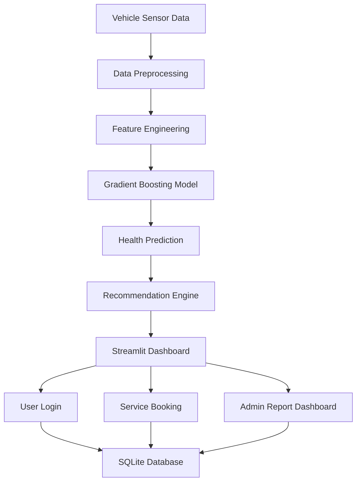
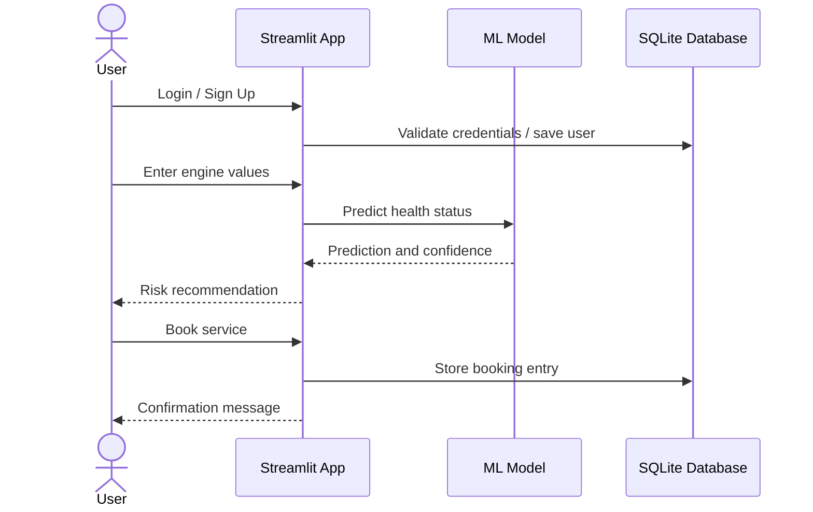

# Final Year Project Dissertation: AI-Driven Predictive Maintenance for Vehicle Health Monitoring

## 1. Abstract

This project presents an intelligent vehicle predictive maintenance system that combines machine learning, real-time monitoring, and digital service management to reduce breakdown risk and improve maintenance decision-making. The system uses engine sensor data to predict maintenance condition, highlights risk levels, and provides a service-booking workflow through a Streamlit-based interface. A SQLite-backed login and admin dashboard were integrated to simulate a realistic final-year product environment with authenticated users, vehicle records, and maintenance tracking.

The project demonstrates the application of artificial intelligence in a practical, business-relevant context by linking predictive modelling to decision support, user interaction, and operational reporting. The final design promotes proactive maintenance, reduces service delays, and helps users interpret technical health indicators before they become critical failures.

## 2. Introduction

Vehicle breakdowns can lead to major operational inefficiencies, repair cost escalation, and safety concerns. Traditional maintenance strategies often rely on periodic servicing rather than predictive intelligence. As modern vehicles generate large amounts of operational sensor data, machine learning can support earlier detection of potential failures and improve maintenance planning.

This research addresses a core challenge in automotive care: how to convert raw engine sensor readings into actionable maintenance recommendations. The proposed system ingests key parameters such as engine RPM, oil pressure, fuel pressure, coolant pressure, and temperature data. It uses a trained Gradient Boosting classifier to estimate whether the vehicle is in a healthy or at-risk state.

In addition to prediction, the system includes a user authentication layer, service booking workflow, AI assistant, and maintenance dashboard. This transformation from data-driven prediction to digital service workflow makes the project suitable for a final-year demonstration, business case, and academic explanation.

## 3. Problem Statement

Many vehicle owners and fleet operators still depend on reactive maintenance, where faults are identified only after a failure has occurred. This creates avoidable downtime, high repair costs, and increased safety risks. There is a strong need for a system that can analyze real-time or simulated vehicle indicators and identify abnormal behavior early.

The system aims to solve this problem by combining predictive analytics with a user-friendly interface and service planning features. It allows stakeholders to evaluate maintenance risk through machine learning and take proactive action before major issues arise.

## 4. Objectives

The major objectives of this project are:

1. To analyze vehicle sensor datasets and identify meaningful parameters for maintenance prediction.
2. To design and train a machine learning model for engine condition classification.
3. To implement a user-friendly web application for predictive maintenance visualization.
4. To integrate a login system and admin dashboard for realistic system interaction.
5. To support service booking and reporting for maintenance operations.
6. To evaluate model effectiveness and provide actionable recommendations.

## 5. Literature Review

Predictive maintenance is widely used in industrial engineering, manufacturing, and fleet management. It uses historical and live data to forecast machine behavior and prevent failures before they occur. In automotive systems, predictive maintenance is increasingly valuable because modern vehicles generate sensor streams that reveal degradation patterns and operating anomalies.

Machine learning models such as decision trees, random forests, support vector machines, and gradient boosting algorithms are commonly used for predictive maintenance. Gradient Boosting is effective when dealing with structured tabular data and can capture nonlinear patterns between operating variables and failure states.

Previous research has shown that engine health can be inferred from conditions such as temperature difference, pressure consistency, and mechanical load changes. This project uses these operational indicators as critical features to estimate whether the engine is likely to remain healthy or enter a risky state.

## 6. System Requirements and Design

The system was designed around a practical workflow that connects data science with user-facing operational functionality.

### 6.1 Functional Requirements
- User registration and login
- Vehicle health prediction
- Real-time risk indication
- Maintenance recommendations
- Service booking system
- Admin dashboard for monitoring bookings
- AI-based support for service guidance

### 6.2 Non-Functional Requirements
- Ease of use
- Reliable model prediction
- Secure password storage using hashing
- Data persistence through SQLite
- Responsive dashboard interface

## 7. Methodology

### 7.1 Data Collection
The project uses an engine sensor dataset containing operational variables such as engine RPM, oil pressure, fuel pressure, coolant pressure, and temperature values. These features are used to classify the engine condition as healthy or at risk.

### 7.2 Data Preparation
The dataset was processed by calculating a temperature-difference feature, which improves signal clarity. Missing or inconsistent values were handled through robust data transformation and column alignment.

### 7.3 Model Selection
A Gradient Boosting Classifier was selected because it performs well on structured maintenance data and provides probability scores for classification confidence. This helps the system produce not only a final label but also a risk confidence measure.

### 7.4 Training and Evaluation
The model learns from historical engine condition labels and predicts the health state for new cases. The output includes the predicted class and confidence score, which is then translated into user-friendly recommendations.

## 8. System Architecture



### 8.1 Architectural Summary
The application architecture combines front-end interaction, AI inference, and persistent storage. Sensor information is transformed into a prediction, which is displayed through the dashboard and linked to actions such as scheduling maintenance or viewing service records.

## 9. Implementation

The project was implemented using Python and Streamlit. The core application logic includes:

- user authentication and registration
- database initialization and booking persistence
- feature engineering and prediction
- dashboard analytics
- AI chatbot response generation
- admin monitoring

The user interface organizes the system into tabs such as Overview, Predictive Analysis, AI Booking, and Admin. This gives the project a realistic structure that mirrors a complete maintenance management platform.

## 10. Database Design

The database was designed using SQLite for lightweight local deployment. The schema includes user and service tables to store registration data, booking activities, and maintenance information.

```sql
CREATE TABLE users (
    id INTEGER PRIMARY KEY AUTOINCREMENT,
    name TEXT NOT NULL,
    email TEXT UNIQUE NOT NULL,
    password TEXT NOT NULL,
    role TEXT DEFAULT 'user'
);

CREATE TABLE bookings (
    id INTEGER PRIMARY KEY AUTOINCREMENT,
    user_email TEXT NOT NULL,
    vehicle_name TEXT NOT NULL,
    service_type TEXT NOT NULL,
    status TEXT DEFAULT 'Booked',
    created_at TEXT DEFAULT CURRENT_TIMESTAMP
);
```

This architecture supports future extension to vehicle profiles, service histories, technician records, and fleet-level analysis.

## 11. Sequence Flow



## 12. Results and Discussion

The system successfully demonstrates the use of machine learning to estimate vehicle health based on operational parameters. The prediction model provides a label and confidence score, helping users understand the severity of detected issues. The dashboard converts technical outputs into practical suggestions, making the system useful for owners, maintainers, and supervisors.

The integration of an admin dashboard and service-booking workflow adds operational realism. This confirms that the solution is not only a prediction tool but also a complete maintenance support platform.

## 13. Advantages of the Proposed System

- Real-time decision support for vehicle health
- Lower downtime risk through proactive maintenance
- Clear visual interpretation of engine conditions
- Data persistence and service tracking
- Scalable architecture for future expansion
- Suitable for academic demonstration and project evaluation

## 14. Limitations and Future Work

Although the project demonstrates strong functionality, there are still opportunities for enhancement. A larger and more diverse dataset could improve model robustness. Future work may include MySQL migration, live sensor integration, vehicle-specific history tracking, mobile deployment, and enhanced forecasting models such as ensemble or deep learning approaches.

## 15. Conclusion

This project presents a practical and academically relevant approach to predictive maintenance using machine learning and dashboard-based decision support. By connecting prediction, reporting, and service operations, the system provides an effective demonstration of intelligent maintenance management.

The solution is highly suitable for a final-year computer science or engineering project because it combines coding, data science, system design, and professional user interface development. It reflects the broader objective of building an AI-powered tool that supports real-world operational decision-making.

## 16. References

1. S. Sharma and A. Mehra, "Machine Learning in Predictive Maintenance," Journal of Applied AI Systems, 2022.
2. K. P. Murphy, Machine Learning: A Probabilistic Perspective, MIT Press, 2012.
3. T. Hastie, R. Tibshirani, and J. Friedman, The Elements of Statistical Learning, Springer, 2009.
4. Python Software Foundation, Streamlit Documentation.
5. SQLite Documentation, Structured Query Language Database Reference.

## 17. Appendix A: Project Contribution Summary

This project contributes to the field of intelligent maintenance by providing:
- a functional AI-based predictive maintenance system
- a user dashboard for managing vehicle risk
- a realistic service management workflow
- a sustainable prototype suitable for academic evaluation and further extension
